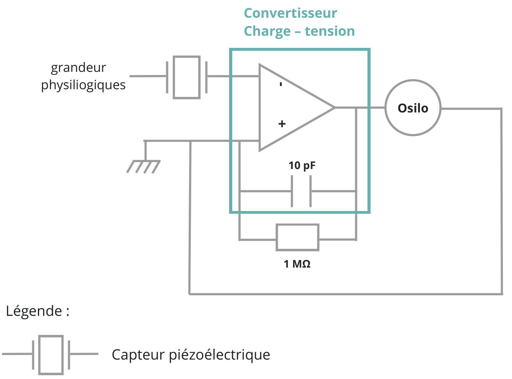
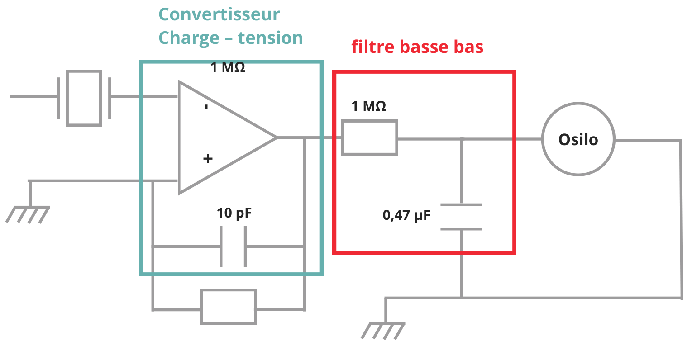
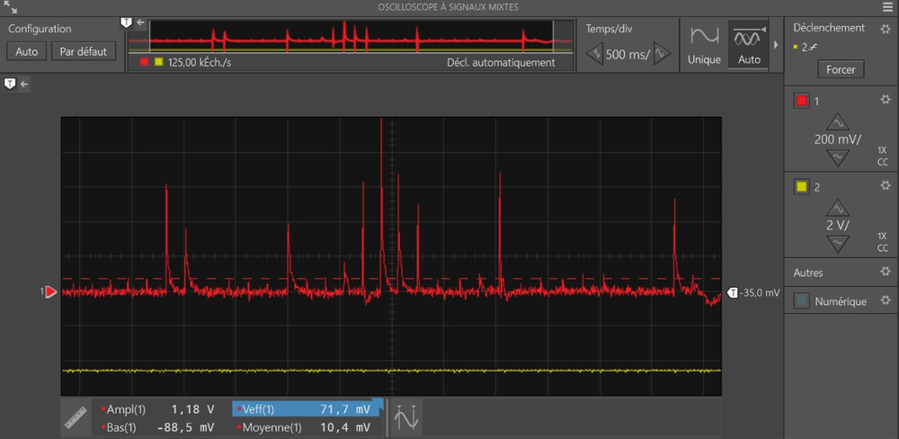
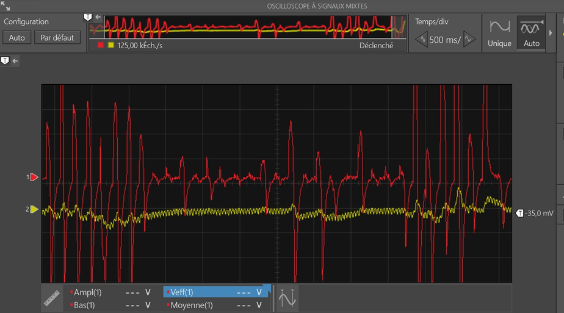
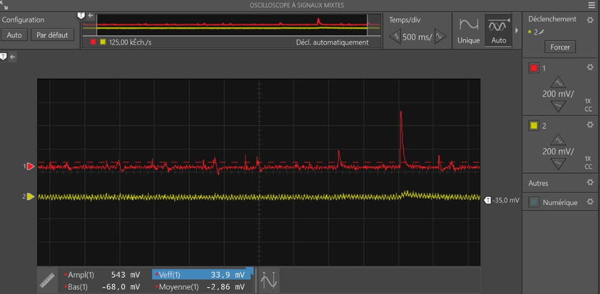

# Détection du pouls par capteur piézoélectrique

*[English version below](#pulse-detection-with-a-piezoelectric-sensor)*

## Objectif

Détecter les battements cardiaques à partir des vibrations mécaniques transmises par l'artère carotide au niveau du cou. Un capteur piézoélectrique convertit ces vibrations en signal électrique, que l'on conditionne (conversion puis filtrage) pour l'observer à l'oscilloscope.

## Principe physique

Un matériau piézoélectrique se polarise quand on le déforme : une contrainte mécanique fait apparaître une charge électrique *Q* proportionnelle à la force appliquée (effet piézoélectrique direct). Le capteur se comporte donc comme une **source de charge** placée en parallèle sur une petite capacité interne. Comme la charge produite est très faible et s'écoule dans l'impédance de l'appareil de mesure, on ne la mesure pas directement : on la convertit d'abord en tension avec un amplificateur opérationnel.

En première approche, avec un condensateur de contre-réaction *C*f, un convertisseur charge-tension idéal fournit :

$$V_s = -\frac{Q}{C_f}$$

## Montage

### Montage initial : convertisseur charge-tension seul

Au départ, nous voulions ne garder que l'alternance positive du signal, puis calculer la périodicité des battements par logiciel. Ce montage ne donnait pas d'affichage exploitable à l'oscilloscope. Nous avons donc gardé le signal complet et ajouté un convertisseur charge-tension.

| Composant | Rôle |
|---|---|
| Capteur piézoélectrique | Convertit les vibrations du cou en charge électrique |
| Amplificateur opérationnel (entrée − sur le capteur, entrée + à la masse) | Maintient le capteur à un potentiel nul (masse virtuelle) et fournit une tension de sortie proportionnelle à la charge |
| *C*f = 10 pF (contre-réaction) | Fixe le gain de conversion charge → tension (*V*s = −*Q*/*C*f) |
| *R*f = 1 MΩ (contre-réaction, en parallèle sur *C*f) | Décharge *C*f pour éviter la dérive et la saturation de la sortie ; plus grande valeur disponible au laboratoire |
| Oscilloscope NI VirtualBench | Visualise la tension de sortie |

L'amplificateur était alimenté en ±9 V par l'alimentation du VirtualBench.

### Montage final : ajout d'un filtre passe-bas RC

| Composant | Rôle |
|---|---|
| *R* = 1 MΩ | Résistance série du filtre passe-bas (plus grande valeur disponible) |
| *C* = 0,47 µF | Condensateur du filtre, vers la masse |

Les deux voies de l'oscilloscope affichent en même temps le signal brut, en sortie du convertisseur (voie rouge), et le signal filtré (voie jaune).

## Calcul de la fréquence de coupure

Pour un filtre RC du premier ordre :

$$f_c = \frac{1}{2\pi R C} = \frac{1}{2\pi \times 1\ \text{M}\Omega \times 0{,}47\ \mu\text{F}} \approx 0{,}34\ \text{Hz}$$

> **Correction par rapport au rapport d'origine :** le rapport indiquait C = 0,47 nF. La valeur réellement utilisée, et reportée sur le schéma, est **0,47 µF**. Avec 0,47 nF, la fréquence de coupure aurait été d'environ 340 Hz.

## Tests et observations

**Capteur sollicité au doigt, sans filtre.** Chaque appui produit un pic de tension net (amplitude crête à crête mesurée : 1,18 V). Le capteur réagit donc bien aux sollicitations mécaniques, mais le signal est bruité.

**Capteur tapoté au doigt, avec filtre.** Le signal brut (rouge) présente des pics de très forte amplitude et beaucoup de bruit. Le signal filtré (jaune) est nettement lissé : les variations brusques et le bruit haute fréquence sont fortement atténués.

**Capteur sur la carotide.** L'amplitude du signal produit par les battements est très faible. Le signal filtré reste difficile à interpréter parce que le signal utile est du même ordre de grandeur que le bruit.

## Difficultés et limites

- **Montage initial non exploitable** : garder uniquement l'alternance positive ne donnait pas d'affichage stable à l'oscilloscope.
- **Signal carotidien très faible** : le rapport signal sur bruit est insuffisant pour lire clairement les battements.
- **Fréquence de coupure trop basse** : au repos, le pouls se situe entre 1 et 1,7 Hz environ (60 à 100 battements par minute). Avec *f*c ≈ 0,34 Hz, le filtre atténue déjà la fondamentale du pouls (gain d'environ 0,27 à 1,2 Hz). Il élimine donc une partie du signal que l'on cherche à mesurer.
- **Constante de temps du convertisseur** : avec *R*f = 1 MΩ et *C*f = 10 pF, la fréquence de coupure basse du convertisseur vaut 1/(2π·*R*f·*C*f) ≈ 16 kHz. Aux fréquences cardiaques, le montage ne fonctionne donc pas vraiment en convertisseur de charge. Il répond surtout aux variations rapides de charge, ce qui favorise les pics et défavorise la composante lente du pouls.
- **Charge du filtre par l'oscilloscope** : l'impédance d'entrée de l'oscilloscope (1 MΩ) est du même ordre que *R*. Elle forme un diviseur de tension avec le filtre et modifie sa fréquence de coupure réelle.
- **Composants imposés** : les valeurs ont été choisies parmi celles disponibles au laboratoire, pas à partir d'un cahier des charges.

## Pistes d'amélioration

- Choisir un filtre **passe-bande** d'environ 0,5 à 10 Hz pour garder la fondamentale et les premières harmoniques du pouls, tout en supprimant la dérive lente et le bruit.
- Utiliser une résistance de contre-réaction bien plus grande (100 MΩ à 1 GΩ) ou augmenter *C*f, pour abaisser la fréquence basse du convertisseur sous 0,5 Hz.
- Ajouter un **étage d'amplification** après le convertisseur et un **suiveur** (buffer) avant l'oscilloscope.
- Améliorer le couplage mécanique (support souple, pression constante) et blinder le câblage.
- Numériser le signal (carte d'acquisition ou microcontrôleur) pour calculer la fréquence cardiaque par logiciel (autocorrélation, FFT ou détection de pics).

---

# Pulse detection with a piezoelectric sensor

## Objective

Detect the heartbeat from the mechanical vibrations that the carotid artery transmits to the neck. A piezoelectric sensor converts these vibrations into an electrical signal, which is then conditioned (conversion and filtering) and displayed on an oscilloscope.

## Physical principle

A piezoelectric material becomes polarised when it is deformed: mechanical stress produces an electric charge *Q* proportional to the applied force (direct piezoelectric effect). The sensor therefore acts as a **charge source** in parallel with a small internal capacitance. The charge is very small and leaks into the impedance of the measuring instrument, so it is not measured directly: an operational amplifier first converts it into a voltage.

To a first approximation, an ideal charge amplifier with a feedback capacitor *C*f gives:

$$V_{out} = -\frac{Q}{C_f}$$

## Circuit

### Initial circuit: charge amplifier only

At first we wanted to keep only the positive half of the signal, then work out the beat period in software. That circuit did not produce a usable oscilloscope display. We therefore kept the full signal and added a charge amplifier.

| Component | Role |
|---|---|
| Piezoelectric sensor | Converts neck vibrations into electric charge |
| Op-amp (− input to the sensor, + input to ground) | Holds the sensor at zero potential (virtual ground) and outputs a voltage proportional to the charge |
| *C*f = 10 pF (feedback) | Sets the charge-to-voltage gain (*V*out = −*Q*/*C*f) |
| *R*f = 1 MΩ (feedback, in parallel with *C*f) | Discharges *C*f to prevent drift and output saturation; largest value available in the lab |
| NI VirtualBench oscilloscope | Displays the output voltage |

The op-amp was powered at ±9 V from the VirtualBench supply.

### Final circuit: added RC low-pass filter

| Component | Role |
|---|---|
| *R* = 1 MΩ | Series resistor of the low-pass filter (largest value available) |
| *C* = 0.47 µF | Filter capacitor to ground |

The two oscilloscope channels show at the same time the raw signal at the charge amplifier output (red trace) and the filtered signal (yellow trace).

## Cut-off frequency

For a first-order RC filter:

$$f_c = \frac{1}{2\pi R C} = \frac{1}{2\pi \times 1\ \text{M}\Omega \times 0.47\ \mu\text{F}} \approx 0.34\ \text{Hz}$$

> **Correction to the original report:** the report stated C = 0.47 nF. The value actually used, and shown on the diagram, is **0.47 µF**. With 0.47 nF the cut-off would have been about 340 Hz.

## Tests and observations

**Sensor pressed with a finger, no filter.** Each press produces a clear voltage spike (measured peak-to-peak amplitude: 1.18 V). The sensor responds well to mechanical stress, but the signal is noisy.

**Sensor tapped with a finger, with filter.** The raw signal (red) shows very large spikes and a lot of noise. The filtered signal (yellow) is much smoother: sudden changes and high-frequency noise are strongly attenuated.

**Sensor on the carotid artery.** The signal produced by the heartbeat is very small. The filtered signal remains hard to interpret because the useful signal is about as large as the noise.

## Difficulties and limitations

- **Initial circuit unusable**: keeping only the positive half-wave did not give a stable oscilloscope display.
- **Very weak carotid signal**: the signal-to-noise ratio is too low to read the beats clearly.
- **Cut-off frequency too low**: a resting pulse is roughly 1 to 1.7 Hz (60 to 100 beats per minute). With *f*c ≈ 0.34 Hz, the filter already attenuates the pulse fundamental (gain of about 0.27 at 1.2 Hz). It therefore removes part of the signal being measured.
- **Charge amplifier time constant**: with *R*f = 1 MΩ and *C*f = 10 pF, the amplifier's lower cut-off is 1/(2π·*R*f·*C*f) ≈ 16 kHz. At heart-rate frequencies the circuit does not really work as a charge amplifier. It mainly responds to fast changes in charge, which favours spikes over the slow pulse component.
- **Oscilloscope loading the filter**: the oscilloscope input impedance (1 MΩ) is close to *R*. It forms a voltage divider with the filter and shifts the actual cut-off frequency.
- **Fixed component set**: values were picked from what the lab had, not from a specification.

## Possible improvements

- Use a **band-pass** filter of about 0.5 to 10 Hz to keep the pulse fundamental and first harmonics while removing slow drift and noise.
- Use a much larger feedback resistor (100 MΩ to 1 GΩ) or a larger *C*f, so the amplifier's lower cut-off drops below 0.5 Hz.
- Add an **amplification stage** after the charge amplifier and a **buffer** before the oscilloscope.
- Improve the mechanical coupling (soft mount, constant pressure) and shield the wiring.
- Digitise the signal (DAQ board or microcontroller) and compute the heart rate in software (autocorrelation, FFT or peak detection).
