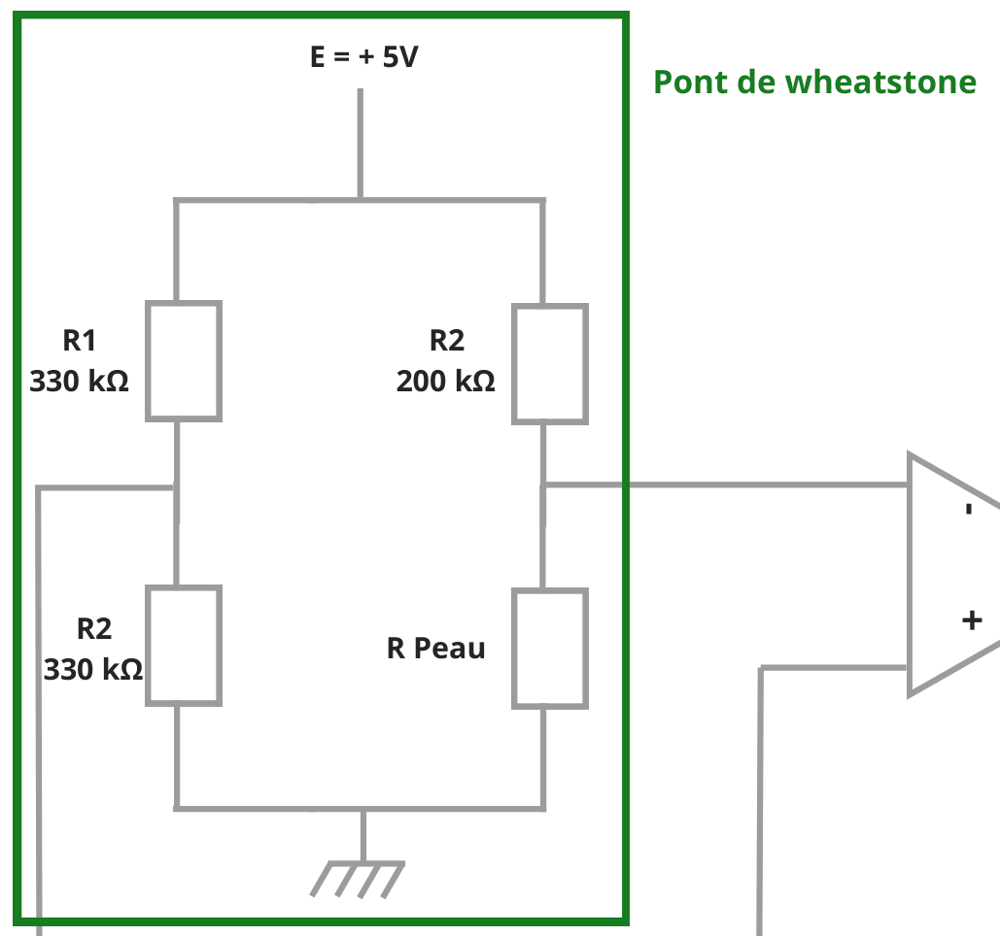
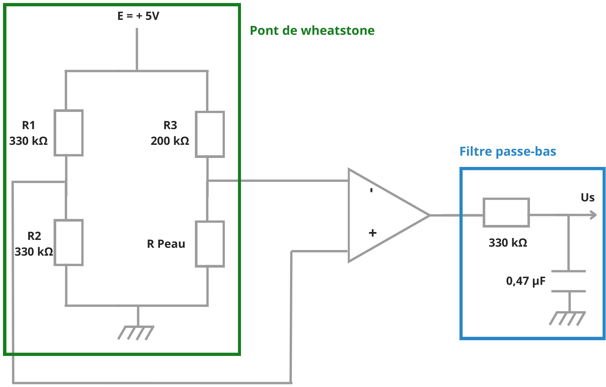
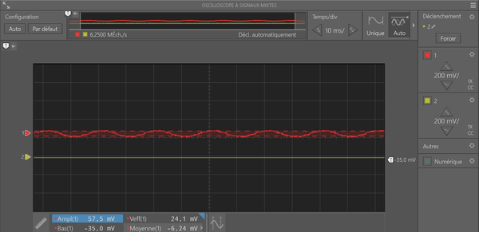
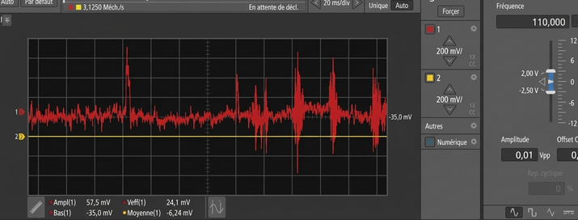
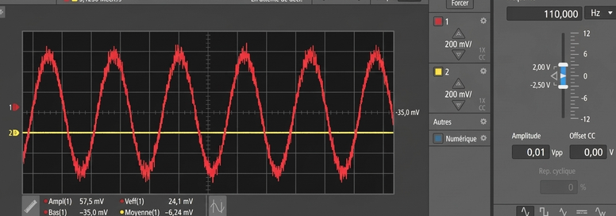

# Mesure de la résistance cutanée

*[English version below](#skin-resistance-measurement)*

## Objectif

Mesurer la résistance électrique de la peau (réponse électrodermale) et suivre ses variations, qui reflètent l'activité du système nerveux autonome par l'intermédiaire de la sudation. Ce type de mesure sert dans les dispositifs nomades à estimer le stress, l'émotion ou l'effort.

## Principe physique

La résistance de la peau dépend surtout de l'activité des glandes sudoripares. Quand la sudation augmente (stress, effort, stimulation), la sueur, riche en ions, rend la peau plus conductrice : sa résistance diminue.

Pour la mesurer, on place deux électrodes sur la peau et on fait passer un très faible courant. La tension qui en résulte dépend de la résistance cutanée *R*peau. On insère pour cela la peau dans un **pont de Wheatstone**, qui transforme une variation de résistance en différence de potentiel.

Avec *E* = 5 V, *R*1 = *R*2 = 330 kΩ et *R*3 = 200 kΩ :

$$V_+ = E\,\frac{R_2}{R_1 + R_2} = 2{,}5\ \text{V} \qquad V_- = E\,\frac{R_\text{peau}}{R_3 + R_\text{peau}}$$

Le pont est équilibré (*V*+ = *V*−) quand *R*peau = *R*3 = 200 kΩ. Le courant qui traverse la peau reste inférieur à *E*/*R*3 = 25 µA, ce qui est sans danger.

## Montage

### Montage initial : pont de Wheatstone et amplificateur

Au départ, nous voulions équilibrer le pont au repos, puis suivre la tension de déséquilibre provoquée par les stimuli.

### Montage final : pont, amplificateur différentiel et filtre passe-bas

| Composant | Rôle |
|---|---|
| *E* = +5 V | Alimente le pont |
| *R*1 = *R*2 = 330 kΩ | Diviseur de référence : fixe *V*+ à 2,5 V |
| *R*3 = 200 kΩ | Résistance de la branche de mesure, en série avec la peau ; fixe le point d'équilibre |
| *R*peau (électrodes) | Élément sensible : sa résistance varie avec la sudation |
| Amplificateur opérationnel monté en **amplificateur différentiel** | Amplifie la différence *V*+ − *V*− entre les deux points milieux du pont et rejette la tension commune |
| *R* = 330 kΩ et *C* = 0,47 µF | Filtre passe-bas RC en sortie : garde la composante lente de la résistance cutanée et supprime le bruit (dont le 50 Hz du secteur) |

> **Correction par rapport au rapport d'origine :** une section du rapport présentait l'étage placé après le pont comme un « convertisseur charge-tension ». Il s'agit en réalité d'un **amplificateur différentiel** : il amplifie la tension de déséquilibre du pont, et la peau ne fournit aucune charge à convertir.

Le montage était alimenté en ±5 V par le VirtualBench, qui fournissait aussi le +5 V du pont.

## Calcul de la fréquence de coupure

$$f_c = \frac{1}{2\pi R C} = \frac{1}{2\pi \times 330\ \text{k}\Omega \times 0{,}47\ \mu\text{F}} \approx 1{,}03\ \text{Hz}$$

> **Correction par rapport au rapport d'origine :** le filtre final est bien constitué de **330 kΩ et 0,47 µF**, comme sur le schéma. La fréquence de coupure vaut donc environ 1,03 Hz.

Les variations de la réponse électrodermale se situent pour l'essentiel sous 1 Hz : le filtre les conserve. À 50 Hz, l'atténuation atteint environ 34 dB.

## Tests et observations

**Validation de l'amplificateur sur signal sinusoïdal.** Nous avons injecté une sinusoïde de 10 mV crête à crête à 110 Hz. La voie rouge (sortie de l'amplificateur) montre une sinusoïde amplifiée : l'amplitude mesurée est de 57,5 mV, soit un gain de l'ordre de 6, bruit compris. La voie jaune (sortie du filtre) est plate : à 110 Hz, le filtre atténue d'environ 40 dB, ce qui est cohérent avec *f*c ≈ 1 Hz.

**Variation d'appui du doigt sur les électrodes.** Le signal brut (rouge) présente de grands pics et beaucoup de bruit, dus aux mouvements. Le signal filtré (jaune) supprime ces variations brusques.

**Simulation de la sudation à l'eau salée.** Pour reproduire une sudation légère de façon contrôlée, nous avons appliqué de l'eau salée sur la zone de mesure. Les ions augmentent la conductivité de la peau et donc diminuent sa résistance. Le rapport indique que la voie filtrée permettait de suivre la variation de tension correspondante, sans les parasites ambiants.

## Difficultés et limites

- **Équilibrage du pont délicat** : la résistance de la peau varie beaucoup d'une personne à l'autre et selon l'humidité. Une résistance *R*3 fixe ne permet pas d'équilibrer le pont dans tous les cas.
- **Sensibilité aux parasites** : bruit secteur à 50 Hz et artefacts liés au mouvement des électrodes.
- **Signal utile faible** : sans amplification ni filtrage, l'affichage direct à l'oscilloscope n'était pas stable.
- **Gain non documenté** : les résistances qui fixent le gain de l'amplificateur différentiel ne figurent pas sur le schéma. La valeur d'environ 6 est estimée à partir de la mesure.
- **Captures peu lisibles pour la variation lente** : avec l'échelle de 200 mV/div, la variation lente de la voie filtrée ne se voit pas nettement sur la capture à l'eau salée. Il faudrait un enregistrement plus long avec une échelle plus sensible.
- **Charge du filtre** : l'impédance d'entrée de l'oscilloscope (1 MΩ) n'est pas très grande devant 330 kΩ. Elle réduit l'amplitude et décale légèrement la fréquence de coupure réelle.

## Pistes d'amélioration

- Remplacer *R*3 par un **potentiomètre** pour équilibrer le pont selon la personne.
- Utiliser un **amplificateur d'instrumentation** (meilleure réjection du mode commun, gain réglable par une seule résistance).
- Ajouter un **suiveur** après le filtre, ou passer à un filtre actif d'ordre 2 avec une fréquence de coupure plus basse (0,5 Hz par exemple).
- Utiliser des électrodes Ag/AgCl avec gel, fixées à un endroit stable (phalanges), pour limiter les artefacts de mouvement.
- Numériser le signal pour calculer *R*peau en continu et séparer la composante tonique (niveau de base) de la composante phasique (réponses aux stimuli).

---

# Skin resistance measurement

## Objective

Measure the electrical resistance of the skin (electrodermal response) and track its changes, which reflect autonomic nervous system activity through sweating. Wearable devices use this kind of measurement to estimate stress, emotion or effort.

## Physical principle

Skin resistance depends mainly on sweat gland activity. When sweating increases (stress, effort, stimulation), the ion-rich sweat makes the skin more conductive, so its resistance drops.

To measure it, two electrodes are placed on the skin and a very small current flows through it. The resulting voltage depends on the skin resistance *R*skin. The skin is therefore placed in a **Wheatstone bridge**, which turns a change in resistance into a potential difference.

With *E* = 5 V, *R*1 = *R*2 = 330 kΩ and *R*3 = 200 kΩ:

$$V_+ = E\,\frac{R_2}{R_1 + R_2} = 2.5\ \text{V} \qquad V_- = E\,\frac{R_\text{skin}}{R_3 + R_\text{skin}}$$

The bridge is balanced (*V*+ = *V*−) when *R*skin = *R*3 = 200 kΩ. The current through the skin stays below *E*/*R*3 = 25 µA, which is safe.

## Circuit

### Initial circuit: Wheatstone bridge and amplifier

At first we wanted to balance the bridge at rest, then track the imbalance voltage caused by stimuli.

### Final circuit: bridge, differential amplifier and low-pass filter

| Component | Role |
|---|---|
| *E* = +5 V | Powers the bridge |
| *R*1 = *R*2 = 330 kΩ | Reference divider: sets *V*+ to 2.5 V |
| *R*3 = 200 kΩ | Resistor of the measuring branch, in series with the skin; sets the balance point |
| *R*skin (electrodes) | Sensing element: its resistance changes with sweating |
| Op-amp wired as a **differential amplifier** | Amplifies the difference *V*+ − *V*− between the two bridge midpoints and rejects the common-mode voltage |
| *R* = 330 kΩ and *C* = 0.47 µF | Output RC low-pass filter: keeps the slow skin-resistance component and removes noise (including 50 Hz mains) |

> **Correction to the original report:** one section of the report described the stage after the bridge as a "charge-to-voltage converter". It is actually a **differential amplifier**: it amplifies the bridge imbalance voltage, and the skin supplies no charge to convert.

The circuit was powered at ±5 V from the VirtualBench, which also supplied the bridge's +5 V.

## Cut-off frequency

$$f_c = \frac{1}{2\pi R C} = \frac{1}{2\pi \times 330\ \text{k}\Omega \times 0.47\ \mu\text{F}} \approx 1.03\ \text{Hz}$$

> **Correction to the original report:** the final filter does use **330 kΩ and 0.47 µF**, as on the diagram. The cut-off frequency is therefore about 1.03 Hz.

Electrodermal changes lie mostly below 1 Hz, so the filter keeps them. At 50 Hz, attenuation reaches about 34 dB.

## Tests and observations

**Amplifier check with a sine wave.** We injected a 10 mV peak-to-peak sine wave at 110 Hz. The red trace (amplifier output) shows an amplified sine wave: the measured amplitude is 57.5 mV, a gain of roughly 6 including noise. The yellow trace (filter output) is flat: at 110 Hz the filter attenuates by about 40 dB, which matches *f*c ≈ 1 Hz.

**Changing finger pressure on the electrodes.** The raw signal (red) shows large spikes and a lot of noise from movement. The filtered signal (yellow) removes these sudden changes.

**Simulated sweating with salt water.** To reproduce light sweating in a controlled way, we applied salt water to the measuring area. The ions increase skin conductivity, so its resistance drops. The report states that the filtered channel made it possible to follow the corresponding voltage change without ambient interference.

## Difficulties and limitations

- **Hard to balance the bridge**: skin resistance varies widely between people and with humidity. A fixed *R*3 cannot balance the bridge in every case.
- **Sensitivity to interference**: 50 Hz mains noise and artefacts from electrode movement.
- **Weak useful signal**: without amplification and filtering, the direct oscilloscope display was not stable.
- **Undocumented gain**: the resistors that set the differential amplifier's gain are not on the diagram. The value of about 6 is estimated from the measurement.
- **Slow change hard to see on the captures**: at 200 mV/div, the slow change on the filtered channel is not clearly visible in the salt-water capture. A longer recording at a more sensitive scale would be needed.
- **Filter loading**: the oscilloscope input impedance (1 MΩ) is not much larger than 330 kΩ. It reduces the amplitude and slightly shifts the actual cut-off frequency.

## Possible improvements

- Replace *R*3 with a **potentiometer** to balance the bridge for each person.
- Use an **instrumentation amplifier** (better common-mode rejection, gain set by a single resistor).
- Add a **buffer** after the filter, or switch to a second-order active filter with a lower cut-off (0.5 Hz, for example).
- Use Ag/AgCl gel electrodes attached to a stable spot (finger phalanges) to limit motion artefacts.
- Digitise the signal to compute *R*skin continuously and separate the tonic component (baseline level) from the phasic component (responses to stimuli).
